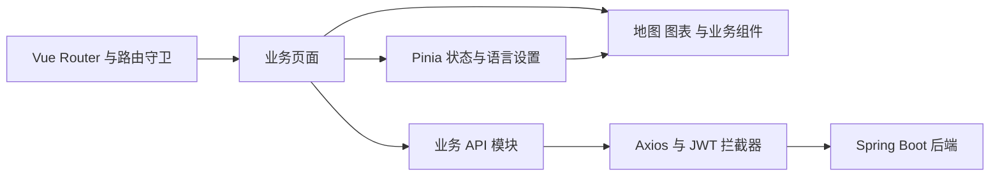

# NAUTIX Frontend

### 船舶监测与态势感知界面

NAUTIX Frontend 是船舶运行监测平台的 Web 客户端，集中展示船舶资料、动态船位、航线、传感器读数、告警与海域天气。项目使用 Vue 3 + TypeScript，结合 ECharts 和 SVG 图层完成数据分析与地图展示，并提供中英双语界面。

[前端仓库](https://github.com/TongYan05/Nautix-Front) · [配套后端](https://github.com/TongYan05/NAUTIX)

## 项目亮点

- **分层刷新**：地图首次加载船舶基础资料、航线、港口与船位；初始化后的常规刷新只请求 **1 个动态船位接口**，减少静态数据的重复加载。
- **地图绘制预算**：采用 Inline SVG 直接绘制船体和方向，单次最多绘制 **800 艘船**；热力点按约 **50 像素网格**聚合，最多绘制 **160 个聚合点**。
- **图表生命周期管理**：`useChart` 封装 ECharts 初始化、配置更新、`ResizeObserver` 自适应和卸载销毁，缓存原始配置以支持切换语言后重绘。
- **中英界面协作**：通过带类型约束的字典、Pinia 语言状态和 Element Plus locale 联动，统一处理界面与图表文案，语言选择保存到 `localStorage`。
- **登录失效处理**：路由守卫检查本地登录状态与过期时间；Axios 自动附加 Bearer Token，在 401 / 403 时清除会话并引导重新登录。

800 和 160 是当前代码的绘制上限，50 是视图坐标下的网格尺度，均不代表压测结果或固定地理距离。

## 主要页面

| 页面 | 路由 | 内容 |
| --- | --- | --- |
| 仪表盘 | `/dashboard` | 业务概况、趋势与分布图表 |
| 船舶管理 | `/ship` | 船舶查询与资料维护 |
| 传感器数据 | `/sensor/realtime` | 读数、过滤与趋势展示 |
| 传感器配置与字典 | `/sensor/config`、`/sensor/dict` | 采集配置与类型维护 |
| 告警记录与规则 | `/alert/records`、`/alert/rules` | 异常记录与阈值规则 |
| 航线与港口 | `/route`、`/port` | 航线、点位与港口资料 |
| 海域天气 | `/weather` | 海域气象展示 |
| 分析中心 | `/analytics` | 业务数据统计与图表 |
| 船队态势 | `/fleet/map/:company?` | 船位与航线地图 |
| 助手工作台 | `/ai` | 问答交互与建议问题 |
| 操作日志 | `/system/logs` | 操作记录查询 |
| 登录与注册 | `/login`、`/register` | 账号注册和登录 |

完整路由及扩展页面见 [router/index.ts](src/router/index.ts)。页面数据与可操作功能取决于对应后端接口和已导入的数据。

## 技术栈

| 用途 | 技术 |
| --- | --- |
| 应用框架 | Vue 3、TypeScript、Vite |
| 路由与状态 | Vue Router、Pinia |
| UI | Element Plus、Element Plus Icons |
| 数据可视化 | ECharts、SVG 图层 |
| HTTP | Axios |
| 国际化 | 自定义类型化字典、语言 Store、图表文案转换 |
| 构建检查 | vue-tsc、npm 锁文件 |

版本以 [package.json](package.json) 和 [package-lock.json](package-lock.json) 为准。当前主要地图图层使用 SVG；依赖中包含 Cesium，但不将所有地图页面描述为已实现 Cesium 三维渲染。

## 前端架构



### 地图数据

`useMapData` 区分初始化与后续刷新。初始化集中加载基础数据并建立按 ID 查找的结构，后续更新动态船位；初次视口适配与后续刷新分开，保留用户当前观察区域。

`ShipLayer` 直接创建 SVG 图形并限制标记数量；`HeatmapLayer` 将投影坐标分桶，按聚合密度设置热力效果。当前船标记上限按输入顺序截取，不等于所有船舶同时可见，也不保证已实现严格的视口优先筛选。

### 图表与语言

`useChart` 在容器可用时创建 ECharts 实例，监听容器尺寸变化，并在卸载时断开观察器、销毁实例。图表文案绘制在 Canvas 中，通过翻译后的 option 更新；页面 DOM 翻译不能替代这一步。

语言状态保存为 `nautix_lang`。英文为字典基准键集，中文按相同键集合约束；`App.vue` 同步 Element Plus 内置文案，部分硬编码展示文本通过 DOM 翻译层处理。数据库中的船名和港口名等业务原始值保留其原始内容。

### 请求与认证

业务请求复用 Axios 实例，超时为 **30 秒**，请求头自动加入本地 Token。响应拦截器直接返回 `response.data`；业务调用方无需再重复取一层 `.data`。

路由守卫使用本地过期信息改善交互，后端仍负责验签和授权。当前请求拦截层在 401 与 403 时都跳转登录，这两种状态的后端语义仍需分别理解。

助手界面通过后端问答接口获取业务回答。后端当前采用规则路由与预置查询，不调用外部 LLM；前端不直接连接数据库。

## 本地运行

### 1. 环境

- Node.js **20.19+（20.x）或 22.12+**，满足当前锁文件中的 Vite 与 Vue 插件要求。
- npm 与 Git。
- 已启动的 NAUTIX 后端；默认地址为 `http://localhost:1910/api`。

数据库准备、后端启动和仿真配置见 [后端 README](https://github.com/TongYan05/NAUTIX/blob/main/README.md)。

### 2. 获取代码

```bash
git clone --branch frontend https://github.com/TongYan05/Nautix-Front.git nautix-frontend
cd nautix-frontend
npm ci
```

### 3. 配置 API 地址

当前 [src/api/axios.ts](src/api/axios.ts) 直接配置：

```ts
const request = axios.create({
  baseURL: 'http://localhost:1910/api',
  timeout: 30000,
})
```

`.env.development` 虽然声明了 `VITE_API_BASE_URL`，当前实例没有读取该变量。更换后端地址时，应修改实例中的 `baseURL`；若希望通过环境变量管理，可将其改为读取 `import.meta.env.VITE_API_BASE_URL`，再配置相应的 `.env` 文件。

`vite.config.ts` 当前没有配置开发代理。如果采用相对路径 `/api`，开发环境也需要添加代理；当前绝对地址方案则依赖后端正确响应 CORS。后端默认允许本机 `localhost` 和 `127.0.0.1` 来源，使用其他域名时需要同步调整后端来源配置。

### 4. 启动

```bash
npm run dev
```

打开终端实际输出的地址，通常为 `http://localhost:5173`。注册账号并登录后，即可访问业务页面；有数据的演示需要后端数据库已导入对应记录。

## 构建与部署

```bash
# 类型检查与生产构建
npm run build

# 本地预览构建产物
npm run preview
```

`build` 执行 `vue-tsc -b && vite build`，产物位于 `dist/`。`preview` 用于本地检查构建产物；生产环境由静态服务器托管，并配置可达的后端 API 地址。

项目使用 History 路由。以下为根路径部署时的 Nginx SPA 回退示例：

```nginx
server {
    listen 80;
    server_name localhost;
    root /var/www/nautix/dist;

    location / {
        try_files $uri $uri/ /index.html;
    }
}
```

该示例仅托管前端。若要在同一域名反向代理 `/api`，需要配置对应代理，并让 Axios 使用相对 API 路径；远端页面不能继续把 `localhost:1910` 当作部署服务器地址。

## 目录结构

```text
nautix-frontend/
├── package.json
├── package-lock.json
├── vite.config.ts
├── index.html
├── public/                  静态资源
└── src/
    ├── App.vue              应用入口与语言联动
    ├── api/                 请求实例与业务接口
    ├── assets/              样式和资源
    ├── components/          地图 图表 与业务组件
    ├── hooks/               可复用图表与地图逻辑
    ├── i18n/                字典与文案转换
    ├── layouts/             主布局与导航
    ├── router/              页面路由与守卫
    ├── stores/              Pinia 状态
    ├── types/               类型定义
    ├── utils/               通用工具
    └── views/               业务页面
```

## 关键源码入口

- [api/axios.ts](src/api/axios.ts)：API 地址、Token、超时与登录失效处理。
- [router/index.ts](src/router/index.ts)：路由懒加载与登录守卫。
- [hooks/useMapData.ts](src/hooks/useMapData.ts)：静态数据初始化与动态位置刷新。
- [components/map/ShipLayer.vue](src/components/map/ShipLayer.vue)：船标记绘制与数量上限。
- [components/map/HeatmapLayer.vue](src/components/map/HeatmapLayer.vue)：网格聚合与热力绘制。
- [hooks/useChart.ts](src/hooks/useChart.ts)：图表更新、尺寸适配与销毁。
- [stores/lang.ts](src/stores/lang.ts)：语言选择与本地持久化。
- [i18n/index.ts](src/i18n/index.ts)：中英字典与类型约束。

## 常见问题

| 现象 | 检查方向 |
| --- | --- |
| 页面打开但没有业务数据 | 后端是否启动、API 地址是否正确、数据库是否存在对应记录 |
| 登录后立即跳回登录页 | 浏览器 Network 中是否出现 401 / 403，Token 是否有效 |
| 修改 `.env` 后地址仍不变化 | Axios 当前使用直接配置的 `baseURL` |
| 部署后刷新子页面返回 404 | 静态服务器是否配置 SPA 回退 |
| 图表尺寸异常 | 容器是否可见且有宽高，是否使用 `useChart` 或正确触发 `resize` |

## 作者

**童颜 / Yan Tong** · 个人独立开发
